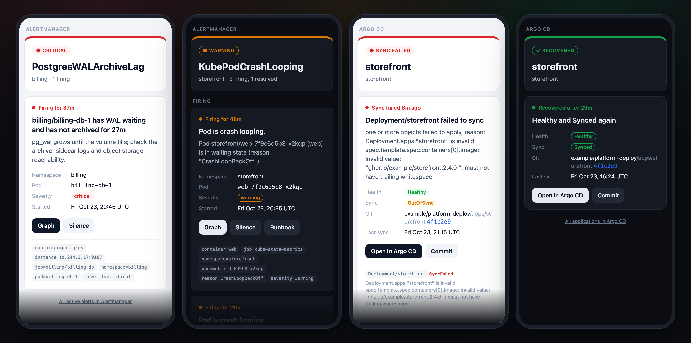
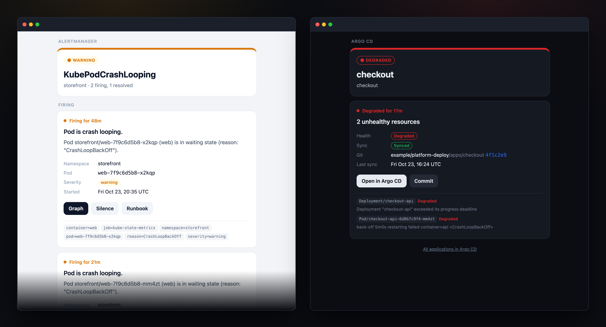
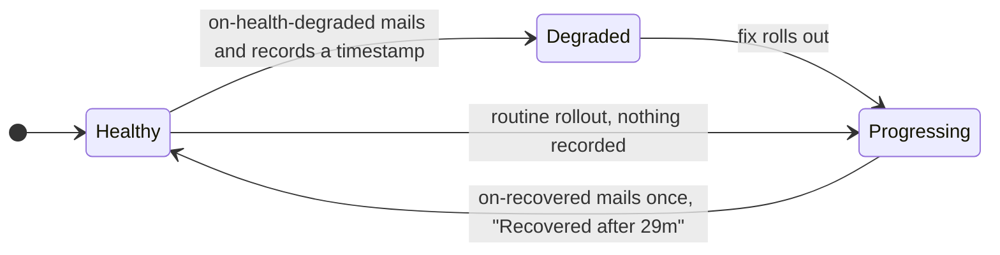

<div align="center">

# Alert email templates

**HTML email templates for Prometheus Alertmanager and Argo CD notifications<br>that read well on any screen, in light and dark.**

[](https://github.com/FYWinds/alert-email-templates/actions/workflows/preview.yml)
[](LICENSE)
[](https://github.com/prometheus/alertmanager)
[](https://github.com/argoproj/argo-cd)

[**Live preview**](https://fywinds.github.io/alert-email-templates/) ·
[Alertmanager](#alertmanager) ·
[Argo CD](#argo-cd) ·
[Preview locally](#preview-locally)



</div>

## Why

The stock Alertmanager email lists every label before it gets to the part that matters, and Argo CD notifications default to a line of plain text. These templates put the state and the message first:

- **Status at a glance.** A colored header and pill per state: critical, warning, resolved, sync failed, degraded, comparison error, recovered.
- **The message first.** Summary and description, or the sync error and the resources it hit, above the details.
- **Buttons that go somewhere.** Graph, Silence and Runbook for alerts; Open in Argo CD and Commit for apps. Optional Grafana links when Alertmanager and Prometheus are not exposed.
- **Short subjects.** `🔴 Critical: PostgresWALArchiveLag · billing` instead of every common label.
- **Any screen, light or dark.** Fills a phone, caps at 560px in a desktop client, and follows the client's dark mode. Plus an inbox preview line and, for Alertmanager, a plain-text part.
- **A recovered email for Argo CD.** One mail when an app is Healthy and Synced again after a problem, and none for routine rollouts.

Every email in the [live preview](https://fywinds.github.io/alert-email-templates/) is rendered on each build by the same `amtool` and `argocd` binaries the servers use. Switch between phone and desktop there, or append `?view=desktop`.



## Alertmanager


[`alertmanager/email.tmpl`](alertmanager/email.tmpl) defines three templates. Load the file and point an email receiver at them:

```yaml
templates:
  - /etc/alertmanager/templates/*.tmpl

receivers:
  - name: email
    email_configs:
      - to: you@example.com
        send_resolved: true
        headers:
          Subject: '{{ template "mail.subject" . }}'
        html: '{{ template "mail.html" . }}'
        text: '{{ template "mail.text" . }}'
```

Full examples: [plain `alertmanager.yml`](alertmanager/examples/alertmanager.yml) and [kube-prometheus-stack values](alertmanager/examples/kube-prometheus-stack.yaml). With the Helm chart, hand the file over with `--set-file`:

```sh
helm upgrade --install kube-prometheus-stack prometheus-community/kube-prometheus-stack \
  -n monitoring -f kube-prometheus-stack.yaml \
  --set-file 'alertmanager.templateFiles.email\.tmpl=alertmanager/email.tmpl'
```

### Settings

Edit the `$cfg` dict at the top of `mail.html`:

| Key | Default | Effect |
|---|---|---|
| `grafanaURL` | `""` | Empty: **Graph** opens the Prometheus link from the rule and **Silence** opens the Alertmanager UI. Set: both open Grafana (Explore and a pre-filled silence). |
| `promUID` | `prometheus` | Grafana datasource uid used by **Graph**. |
| `alertmanagerUID` | `alertmanager` | Grafana datasource uid used by **Silence** and the footer link. |
| `hiddenLabels` | `alertname`, `prometheus` | Labels left out of the label chips. |

Annotations used when present: `summary`, `description`, `runbook_url`. Times are shown in UTC.

## Argo CD


[`argocd/argocd-notifications-cm.yaml`](argocd/argocd-notifications-cm.yaml) holds one HTML template, `app-alert`, used by four triggers:

| Trigger | Fires when | Email |
|---|---|---|
| `on-sync-failed` | the sync operation ends in `Error` or `Failed` | the error, then each resource that failed to apply |
| `on-health-degraded` | health turns `Degraded` | each unhealthy resource with its health message |
| `on-sync-status-unknown` | Argo CD cannot compare the app with git | the `ComparisonError` text |
| `on-recovered` | the app is Healthy and Synced again after one of the above | how long it took, from the first problem email |

Merge the file into your `argocd-notifications-cm` (it replaces the whole `data` map if applied as is), replace the `example.com` values, and add the SMTP password:

```sh
kubectl -n argocd patch secret argocd-notifications-secret --type merge \
  -p '{"stringData":{"email-password":"<smtp password>"}}'
```

`html: true` on the email service makes every email from that service HTML, and `context.argocdUrl` feeds the **Open in Argo CD** button.

### How "recovered" works

Argo CD's notification engine remembers which triggers it has mailed in the `notified.notifications.argoproj.io` annotation on each Application. Entries of triggers with `oncePer` stay there after the condition clears; the others are dropped at once. All three problem triggers use `oncePer`, so their timestamped entries survive whatever states the app passes through on its way back:



`on-recovered` fires when the app is Healthy and Synced with a recorded problem, and uses the newest problem timestamp as its own `oncePer`, so each problem gets exactly one recovery email. CI checks this against six fixture apps on every build.

## Preview locally

```sh
preview/fetch-tools.sh                 # pinned amtool and argocd into preview/bin/
pip install pyyaml
python3 preview/build.py               # checks, trigger tests, renders into site/
python3 -m http.server -d site 8000    # http://localhost:8000
```

`build.py` fails if the example config does not pass `amtool check-config`, if any scenario fails to render, or if a trigger fires for the wrong fixture. Scenarios are defined in the script; edit them to preview your own alerts. The Argo CD CLI renders from files only, no cluster needed.

## Compatibility

| | Minimum | Tested |
|---|---|---|
| Alertmanager | 0.28 (`dict`, `list`, `toJson` template functions) | 0.34.1 |
| Argo CD | 3.0 (`status.health.lastTransitionTime`) | 3.5.5 |

The HTML is table-based with inline styles; dark mode uses `prefers-color-scheme`, which Apple Mail, iOS Mail and Outlook for Mac honor. Clients without it show the light version.

## License

[MIT](LICENSE) © 2026 FYWinds
