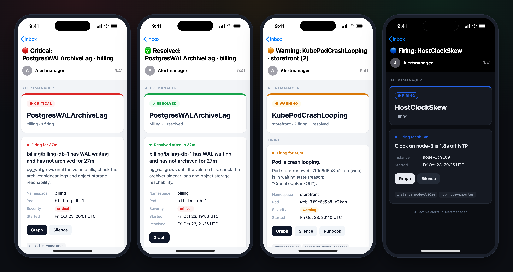

# Alertmanager



[`email.tmpl`](email.tmpl) defines three templates. Load the file and point an email receiver at them:

```yaml
templates:
  - /etc/alertmanager/templates/*.tmpl

receivers:
  - name: email
    email_configs:
      - to: you@example.com
        send_resolved: true
        headers:
          Subject: '{{ template "mail.subject" . }}'
        html: '{{ template "mail.html" . }}'
        text: '{{ template "mail.text" . }}'
```

Full examples: [plain `alertmanager.yml`](examples/alertmanager.yml) and [kube-prometheus-stack values](examples/kube-prometheus-stack.yaml). With the Helm chart, hand the file over with `--set-file`:

```sh
helm upgrade --install kube-prometheus-stack prometheus-community/kube-prometheus-stack \
  -n monitoring -f kube-prometheus-stack.yaml \
  --set-file 'alertmanager.templateFiles.email\.tmpl=alertmanager/email.tmpl'
```

## Settings

Edit the `$cfg` dict at the top of `mail.html`:

| Key | Default | Effect |
|---|---|---|
| `grafanaURL` | `""` | Empty: **Graph** opens the Prometheus link from the rule and **Silence** opens the Alertmanager UI. Set: both open Grafana (Explore and a pre-filled silence). |
| `promUID` | `prometheus` | Grafana datasource uid used by **Graph**. |
| `alertmanagerUID` | `alertmanager` | Grafana datasource uid used by **Silence** and the footer link. |
| `hiddenLabels` | `alertname`, `prometheus` | Labels left out of the label chips. |

Annotations used when present: `summary`, `description`, `runbook_url`. Times are shown in UTC.
