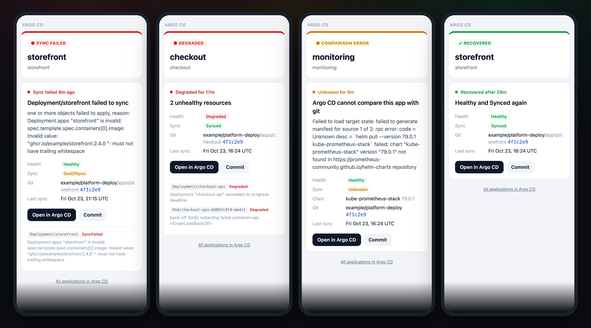
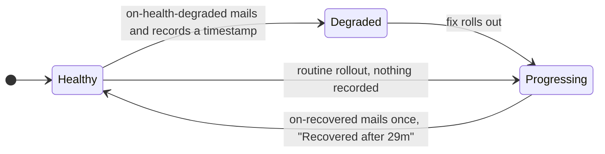

# Argo CD



[`argocd-notifications-cm.yaml`](argocd-notifications-cm.yaml) holds one HTML template, `app-alert`, used by four triggers:

| Trigger | Fires when | Email |
|---|---|---|
| `on-sync-failed` | the sync operation ends in `Error` or `Failed` | the error, then each resource that failed to apply |
| `on-health-degraded` | health turns `Degraded` | each unhealthy resource with its health message |
| `on-sync-status-unknown` | Argo CD cannot compare the app with git | the `ComparisonError` text |
| `on-recovered` | the app is Healthy and Synced again after one of the above | how long it took, from the first problem email |

Merge the file into your `argocd-notifications-cm` (it replaces the whole `data` map if applied as is), replace the `example.com` values, and add the SMTP password:

```sh
kubectl -n argocd patch secret argocd-notifications-secret --type merge \
  -p '{"stringData":{"email-password":"<smtp password>"}}'
```

`html: true` on the email service makes every email from that service HTML, and `context.argocdUrl` feeds the **Open in Argo CD** button.

## How "recovered" works

Argo CD's notification engine remembers which triggers it has mailed in the `notified.notifications.argoproj.io` annotation on each Application. Entries of triggers with `oncePer` stay there after the condition clears; the others are dropped at once. All three problem triggers use `oncePer`, so their timestamped entries survive whatever states the app passes through on its way back:



`on-recovered` fires when the app is Healthy and Synced with a recorded problem, and uses the newest problem timestamp as its own `oncePer`, so each problem gets exactly one recovery email. CI checks this against six fixture apps on every build.
