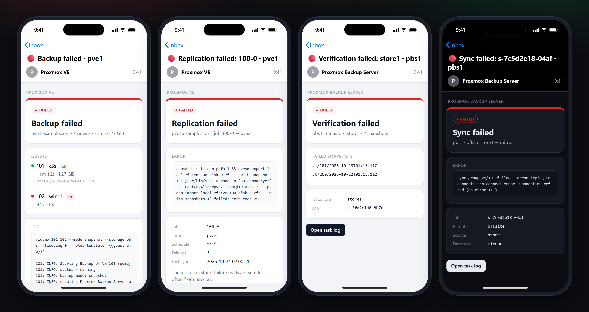

# Proxmox VE and Backup Server



Template overrides for the notification system. Each type has a subject, a plain-text body and an HTML body:

| Directory | Types |
|---|---|
| [`pve/`](pve) | `vzdump` (backups, failed or finished), `replication`, `fencing`, `package-updates`, `test` |
| [`pbs/`](pbs) | `verify-err`, `gc-err`, `prune-err`, `sync-err`, `acme-err`, `test` |

Copy them into the override directory; Proxmox picks them up for the next notification, no restart:

```sh
# PVE, cluster-wide. /etc/pve does not allow chmod, so plain cp rather than install -m.
mkdir -p /etc/pve/notification-templates/default && cp pve/* /etc/pve/notification-templates/default/
# PBS
install -D -m 0644 -t /etc/proxmox-backup/notification-templates/default/ pbs/*
```

The buttons link to `https://<fqdn>:8006` (PVE) and the `base-url` PBS derives from its hostname and DNS search domain (`https://<fqdn>:8007`). If you open the web UI another way, change the `web-url` line at the top of each HTML file:

```sh
sed -i 's|{{#\*inline "web-url"}}.*{{/inline}}|{{#*inline "web-url"}}https://pve.example.com{{/inline}}|' /etc/pve/notification-templates/default/*-body.html.hbs
```

## Notes

- If an override fails to render, Proxmox logs the error and falls back to its stock template.
- The PBS docs only mention plain-text overrides, but its renderer (`proxmox-notify`) loads `*-body.html.hbs` from the override directory as well.
- Mails from local daemons such as smartd and ZFS ZED arrive as type `system-mail` and are forwarded as is; no template applies to them.
- To get only problems, route with `match-severity warning,error,unknown` (`unknown` is the severity of `system-mail`) and disable `default-matcher`. Finished backups and package updates are `info`.
- Requires Proxmox VE 8.4 or later (template overrides). Tested with PVE 9.2 and PBS 4.2.8.

## Editing

The HTML files are generated, because Proxmox loads one file per template without partials. Edit [`src/layout.html.hbs`](src/layout.html.hbs) (page frame and building blocks) or `src/<product>/<type>.html.hbs` (one type), then run `preview/build.py`. It renders the previews with `proxmox-render`, which `preview/fetch-tools.sh` builds with cargo; unlike Proxmox, it fails on a template error instead of falling back to the stock template.
